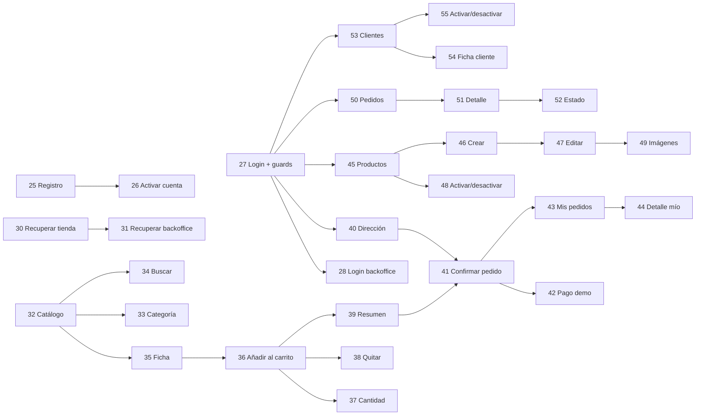

# Backlog del MVP y dependencias

31 historias para 6 equipos (cinco parejas y un trío). Las historias completas, con sus escenarios y la ayuda técnica, están en Jira (**FUR-25 a FUR-55**). La explicación larga está en Confluence, en la página "Orden de trabajo y dependencias".

## 1. Seis carriles, uno por equipo

Cada equipo tiene un **carril**: un bloque del MVP que vive en sus propias carpetas.
Así casi nunca tocáis los mismos ficheros.

| Equipo | Carril | Tarjetas, en orden | Carpetas |
|---|---|---|---|
| 1 (trío) | Acceso | **FUR-27** → 28 → 25 → 26 → 30 → 31 | `api/src/auth`, `api/src/users`, `*/features/auth` |
| 2 | Catálogo | **FUR-32** → 35 → 33 → 34 | `api/src/products` (público), `api/src/categories`, `shop/src/features/catalog` |
| 3 | Carrito | **FUR-36** → 37 → 38 → 39 → 29 → 42 | `shop/src/features/cart`, pago en `shop/src/features/checkout` |
| 4 | Compra | **FUR-40** → 41 → 43 → 44 | `api/src/orders` (`orders.controller.ts`), `shop/src/features/checkout`, `shop/src/features/myOrders` |
| 5 | Productos (backoffice) | **FUR-45** → 48 → 46 → 47 → 49 | `api/src/products` (`admin-products.controller.ts`), `backoffice/src/features/products` |
| 6 | Pedidos y clientes (backoffice) | **FUR-50** → 51 → 52 → 53 → 54 → 55 | `api/src/orders` (`admin-orders.controller.ts`), `api/src/users` (admin), `backoffice/src/features/orders`, `backoffice/src/features/customers` |

En **negrita**, la tarjeta con la que empieza cada equipo el primer día. Ninguna de las seis choca con otra.

Si un equipo acaba su carril, coge tarjetas de otro que vaya con retraso (hablándolo antes).

### Las 31 tarjetas

| Tarjeta | Historia | Tarjeta | Historia |
|---|---|---|---|
| FUR-25 | Registrarse en la tienda | FUR-41 | Confirmar el pedido |
| FUR-26 | Activar la cuenta desde el email | FUR-42 | Pantalla de pago de demostración |
| FUR-27 | Iniciar sesión en la tienda (+ guards) | FUR-43 | Ver mis pedidos |
| FUR-28 | Iniciar sesión en el backoffice | FUR-44 | Ver el detalle de un pedido mío |
| FUR-29 | Cerrar sesión | FUR-45 | Listado de productos (backoffice) |
| FUR-30 | Recuperar la contraseña (tienda) | FUR-46 | Crear un producto |
| FUR-31 | Recuperar la contraseña (backoffice) | FUR-47 | Editar un producto |
| FUR-32 | Ver el catálogo | FUR-48 | Activar o desactivar un producto |
| FUR-33 | Filtrar por categoría | FUR-49 | Añadir imágenes a un producto |
| FUR-34 | Buscar por nombre | FUR-50 | Listado de pedidos (backoffice) |
| FUR-35 | Ficha de producto | FUR-51 | Detalle de un pedido (backoffice) |
| FUR-36 | Añadir al carrito | FUR-52 | Cambiar el estado de un pedido |
| FUR-37 | Cambiar la cantidad | FUR-53 | Listado de clientes |
| FUR-38 | Quitar del carrito | FUR-54 | Ficha de un cliente con sus pedidos |
| FUR-39 | Resumen con IVA y envío | FUR-55 | Activar o desactivar un cliente |
| FUR-40 | Dirección de entrega | | |

## 2. Qué depende de qué

FUR-26, FUR-30 y FUR-31 envían emails: en local salen por la consola; en staging necesitan Brevo configurado.

## 3. Cómo arrancar sin esperar a nadie

La flecha más importante es **FUR-27 → casi todo**: sin login no hay token, y sin token no hay rutas protegidas.
Para que nadie se quede parado:

1. **El equipo 1 hace primero la parte de API de FUR-27**: `POST /api/v1/auth/login`, `GET /api/v1/auth/me`, el `AuthGuard` (comprueba el token) y el `AdminGuard` (comprueba que el rol es `ADMIN`). Objetivo: fusionada el primer día antes de comer.
2. **Mientras tanto, el resto hace la parte que no necesita login**:
   - Equipo 2: `GET /products` es público. Sin bloqueo.
   - Equipo 3: el `cartSlice` y sus tests no necesitan la API. El botón "Añadir" se engancha cuando esté FUR-35.
   - Equipo 4: el formulario de dirección como componente con su test. La página se conecta cuando esté FUR-27.
   - Equipos 5 y 6: el endpoint (`GET /admin/products`, `GET /admin/orders`) y su servicio **sin guard**, probado con Swagger (`http://localhost:3000/docs`). En cuanto se fusione FUR-27, una PR pequeña añade `@UseGuards(AuthGuard, AdminGuard)` y el escenario "una clienta recibe 403".
3. Los datos ya están en la base de datos (`seed.sql`): hay pedidos de Ana para FUR-43, FUR-50 y FUR-54 aunque FUR-41 no esté hecha.

## 4. Ficheros compartidos (ojo)

| Fichero | Quién lo toca | Cómo evitar líos |
|---|---|---|
| `api/src/products/products.module.ts` | Equipos 2 y 5 | El 2 usa `products.controller.ts` (público) y el 5 `admin-products.controller.ts`. En el módulo solo añadís una línea cada uno. |
| `api/src/orders/orders.module.ts` | Equipos 4 y 6 | El 4 usa `orders.controller.ts` (también "mis pedidos"); el 6 `admin-orders.controller.ts`. |
| `api/src/users/` | Equipos 1 y 6 | El 1 crea el servicio; el 6 añade `admin-users.controller.ts`. |
| `api/src/auth/*.guard.ts` | Equipo 1 (los crea) | El resto solo los importa. |
| `shop/src/features/cart/cartSlice.ts` | Equipo 3 (y el 4 lo lee en FUR-41) | El 4 solo usa los selectores. |

Si hay conflicto: `git pull origin main` en vuestra rama, arreglad el conflicto juntos y avisad al profesor si no lo veis claro.

## 5. Contrato de la API

Para que la web y la API avancen a la vez, estas son las rutas acordadas (todas empiezan por `/api/v1`).

| Tarjeta | Ruta | Quién puede |
|---|---|---|
| FUR-25 | `POST /auth/register` | Cualquiera |
| FUR-27 | `POST /auth/login` → solo `{ accessToken }`. El usuario se pide con `GET /auth/me` | Cualquiera / con token |
| FUR-26 | `POST /auth/verify-email` y `POST /auth/resend-verification` | Cualquiera |
| FUR-30, FUR-31 | `POST /auth/forgot-password` y `POST /auth/reset-password` | Cualquiera |
| FUR-39 | `GET /orders/shipping-cost` | Cualquiera |
| FUR-32, FUR-34 | `GET /products?search=nora` (solo `ACTIVE`) | Cualquiera |
| FUR-33 | `GET /categories` y `GET /products?categoryId=...` | Cualquiera |
| FUR-35 | `GET /products/:id` | Cualquiera |
| FUR-41 | `POST /orders` (el servidor calcula precios y stock) | Con token |
| FUR-43, FUR-44 | `GET /orders/mine` y `GET /orders/mine/:id` | Con token (solo los suyos) |
| FUR-45 | `GET /admin/products` (también `INACTIVE`) | `ADMIN` |
| FUR-46, FUR-47 | `POST /admin/products` y `PATCH /admin/products/:id` | `ADMIN` |
| FUR-48 | `DELETE /admin/products/:id` (pasa a `INACTIVE`) | `ADMIN` |
| FUR-49 | `POST /admin/products/:id/images` | `ADMIN` |
| FUR-50, FUR-51 | `GET /admin/orders` y `GET /admin/orders/:id` | `ADMIN` |
| FUR-52 | `PATCH /admin/orders/:id/status` | `ADMIN` |
| FUR-53, FUR-54 | `GET /admin/users` y `GET /admin/users/:id` (sin `passwordHash`) | `ADMIN` |
| FUR-55 | `PATCH /admin/users/:id/status` | `ADMIN` |

## 6. Usuarios de prueba

Todas las cuentas tienen la contraseña `Furniro123`.

| Email | Rol | Para qué |
|---|---|---|
| `luis@furniro.com` | ADMIN | Backoffice |
| `ana@mail.com` | CUSTOMER | Tiene 2 pedidos |
| `pedro@mail.com` | CUSTOMER | No tiene pedidos ni dirección |
