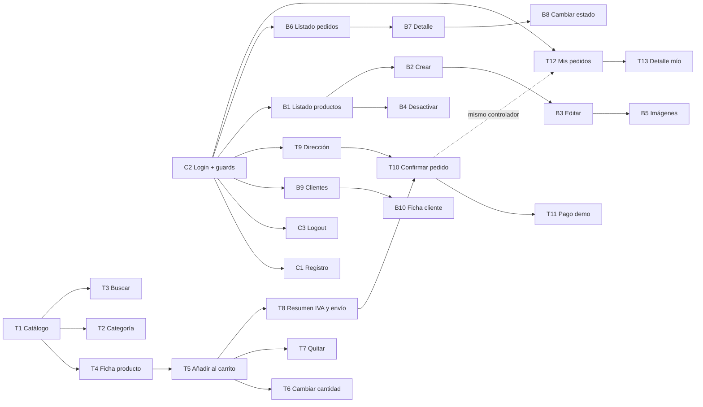

# Backlog del MVP y dependencias

26 tarjetas para 6 parejas (la C4, datos de prueba, ya está hecha: `database/seed.sql`).
Las historias completas, con sus escenarios, están en Jira.

## 1. Seis carriles, uno por pareja

Cada pareja tiene un **carril**: un bloque del MVP que vive en sus propias carpetas.
Así casi nunca tocáis los mismos ficheros.

| Pareja | Carril | Tarjetas, en orden | Carpetas |
|---|---|---|---|
| 1 | Cuentas | **C2** → C1 → C3 → B9 → B10 | `api/src/auth`, `api/src/users`, `*/features/auth`, `backoffice/src/features/customers` |
| 2 | Catálogo | **T1** → T4 → T2 → T3 | `api/src/products` (público), `api/src/categories`, `shop/src/features/catalog` |
| 3 | Carrito | **T5** → T6 → T7 → T8 | `shop/src/features/cart` (no hay API: el carrito vive en la web) |
| 4 | Compra | **T9** → T10 → T11 | `api/src/orders` (crear pedido), `shop/src/features/checkout` |
| 5 | Productos (backoffice) | **B1** → B4 → B2 → B3 → B5 | `api/src/products` (admin), `backoffice/src/features/products` |
| 6 | Pedidos | **B6** → B7 → B8 → T12 → T13 | `api/src/orders` (admin y "mis pedidos"), `backoffice/src/features/orders`, `shop/src/features/myOrders` |

En **negrita**, la tarjeta con la que empieza cada pareja el primer día. Ninguna de las seis choca con otra.

Si una pareja acaba su carril, coge tarjetas de otra que vaya con retraso (hablándolo antes).

## 2. Qué depende de qué

## 3. Cómo arrancar sin esperar a nadie

La flecha más importante es **C2 → casi todo**: sin login no hay token, y sin token no hay rutas protegidas.
Para que nadie se quede parado:

1. **La pareja 1 hace primero la parte de API de C2**: `POST /api/v1/auth/login`, el `AuthGuard` (comprueba el token) y el `AdminGuard` (comprueba que el rol es `ADMIN`). Objetivo: fusionada el primer día antes de comer.
2. **Mientras tanto, el resto hace la parte que no necesita login**:
   - Pareja 2: `GET /products` es público. Sin bloqueo.
   - Pareja 3: el `cartSlice` y sus tests no necesitan la API. El botón "Añadir" se engancha cuando esté T4.
   - Pareja 4: el formulario de dirección como componente con su test. La página se conecta cuando esté C2.
   - Parejas 5 y 6: el endpoint (`GET /admin/products`, `GET /admin/orders`) y su servicio **sin guard**, probado con Swagger. En cuanto se fusione C2, una PR pequeña añade `@UseGuards(AuthGuard, AdminGuard)` y el escenario "una clienta recibe 403".
3. Los datos ya están en la base de datos (`seed.sql`): hay pedidos de Ana para T12 y B6 aunque T10 no esté hecha.

## 4. Ficheros compartidos (ojo)

| Fichero | Quién lo toca | Cómo evitar líos |
|---|---|---|
| `api/src/products/products.module.ts` | Parejas 2 y 5 | La 2 usa `products.controller.ts` (público) y la 5 `admin-products.controller.ts`. En el módulo solo añadís una línea cada uno. |
| `api/src/orders/orders.module.ts` | Parejas 4 y 6 | La 4 usa `orders.controller.ts`; la 6 `admin-orders.controller.ts`. T12 y T13 van al final, cuando T10 ya está fusionada. |
| `api/src/auth/*.guard.ts` | Pareja 1 (los crea) | El resto solo los importa. |
| `shop/src/features/cart/cartSlice.ts` | Pareja 3 (y la 4 lo lee en T10) | La 4 solo usa los selectores. |

Si hay conflicto: `git pull origin main` en vuestra rama, arreglad el conflicto juntos y avisad al profesor si no lo veis claro.

## 5. Contrato de la API

Para que la web y la API avancen a la vez, estas son las rutas acordadas (todas empiezan por `/api/v1`).

| Tarjeta | Ruta | Quién puede |
|---|---|---|
| C1 | `POST /auth/register` | Cualquiera |
| C2 | `POST /auth/login` → `{ accessToken, user }` y `GET /auth/me` | Cualquiera / con token |
| T1, T3 | `GET /products?search=nora` (solo `ACTIVE`) | Cualquiera |
| T2 | `GET /categories` y `GET /products?categoryId=...` | Cualquiera |
| T4 | `GET /products/:id` | Cualquiera |
| T10 | `POST /orders` (el servidor calcula precios y stock) | Con token |
| T12, T13 | `GET /orders/mine` y `GET /orders/mine/:id` | Con token (solo los suyos) |
| B1 | `GET /admin/products` (también `INACTIVE`) | `ADMIN` |
| B2, B3 | `POST /admin/products` y `PATCH /admin/products/:id` | `ADMIN` |
| B4 | `DELETE /admin/products/:id` (pasa a `INACTIVE`) | `ADMIN` |
| B5 | `POST /admin/products/:id/images` | `ADMIN` |
| B6, B7 | `GET /admin/orders` y `GET /admin/orders/:id` | `ADMIN` |
| B8 | `PATCH /admin/orders/:id/status` | `ADMIN` |
| B9, B10 | `GET /admin/users` y `GET /admin/users/:id` (sin `passwordHash`) | `ADMIN` |

## 6. Usuarios de prueba

Todas las cuentas tienen la contraseña `Furniro123`.

| Email | Rol | Para qué |
|---|---|---|
| `luis@furniro.com` | ADMIN | Backoffice |
| `ana@mail.com` | CUSTOMER | Tiene 2 pedidos |
| `pedro@mail.com` | CUSTOMER | No tiene pedidos ni dirección |
