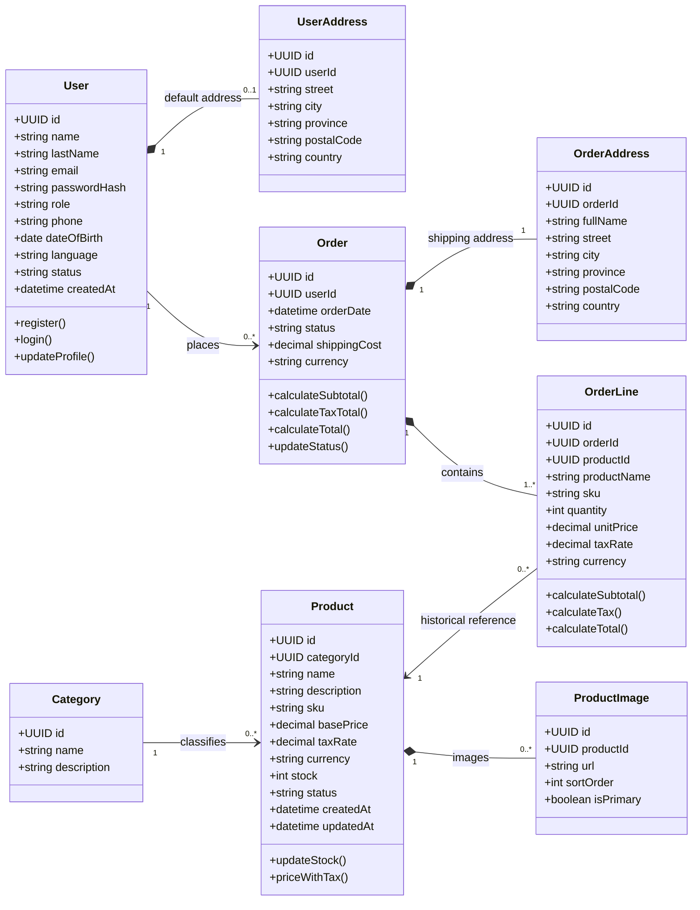

# Furniro — Class Diagram

## Notas

- `role`: `CUSTOMER` o `ADMIN`. No hay clases `Customer` ni `Admin`.
- `Product.status`: `ACTIVE` o `INACTIVE`. Eliminar un producto desde el backoffice lo desactiva (borrado lógico); así `OrderLine.productId` siempre apunta a un producto existente.
- `basePrice` es el precio sin IVA. El precio mostrado al cliente se calcula con `priceWithTax()`.
- Subtotales, IVA y total del pedido no se guardan: se calculan con los métodos `calculate…()` a partir de `OrderLine` y `shippingCost`.
- `UserAddress` es opcional (`0..1`): el usuario puede registrarse sin dirección.
- Un producto puede crearse sin imágenes (`0..*`).
- Los campos `userId`, `orderId`, `productId` y `categoryId` se mantienen porque este diagrama también sirve para diseñar la base de datos.
