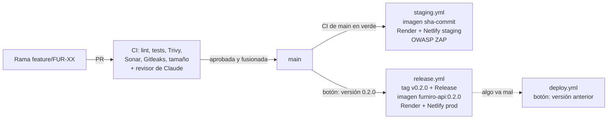

# CI/CD de Furniro

Cómo llega el código de una rama a producción, qué comprueba cada paso y dónde está configurado cada servicio.

## 1. El ciclo completo

En tres frases:

1. **CI**: cada PR pasa los checks. Sin todos en verde, no se puede fusionar.
2. **Staging**: cuando algo entra en `main` y su CI sale en verde, se despliega solo. Staging es siempre el reflejo de `main`.
3. **Producción**: el profesor pulsa un botón y escribe la versión. Se crea el tag y la Release, se publica la imagen en Docker Hub con ese número y se despliega (después de aprobarlo en el entorno `production`).

### ¿Por qué staging no usa versiones?

Staging usa el commit (`staging-abc1234`) y producción usa versiones (`0.2.0`).

- Si staging usara la versión de `package.json`, cada PR tendría que subirla y todas las parejas chocarían en la misma línea.
- La versión es una decisión de producto ("esto ya se puede enseñar"), así que la decide quien pulsa el botón.
- Con el commit se sabe exactamente qué hay en staging: el pie de la web lo enseña (`Web staging-abc1234 · API staging-abc1234`).

Las versiones siguen `MAJOR.MINOR.PATCH`. La primera fue la `0.1.0` (el esqueleto); la `1.0.0` queda para cuando el MVP esté terminado.

### ¿Cómo sabe producción qué desplegar?

**Actions → release → Run workflow** con la versión (por ejemplo `0.2.0`). El workflow:

1. Comprueba que la versión es válida y no existe.
2. Crea el tag `v0.2.0` sobre lo que hay en `main` (lo mismo que ya está en staging) y la GitHub Release. Las notas salen de los **títulos de las PRs**: por eso importa escribirlos bien.
3. Construye la imagen desde ese tag y la sube a Docker Hub como `furniro-api:0.2.0` y `latest`.
4. Espera la aprobación del entorno `production`.
5. Pide a Render que despliegue `furniro-api:0.2.0` y espera a que `/api/v1/health` responda con esa versión.
6. Construye la tienda y el backoffice desde el tag y los sube a Netlify producción.

**Rollback:** **Actions → deploy → Run workflow**, entorno `production` y una versión anterior (`0.1.0`). Vuelve a desplegar esa imagen, y las webs se reconstruyen desde su tag.

Netlify no despliega imágenes Docker, solo ficheros estáticos. Por eso la API va en imagen (Render) y las webs se construyen y se suben con `netlify deploy` desde GitHub Actions.

## 2. Qué hay en el repo

| Fichero | Qué hace |
|---|---|
| `.github/workflows/ci.yml` | Checks de la PR. Solo revisa las carpetas que cambia la PR (`api`, `shop`, `backoffice`, `database`); `pr-size` y `secrets` van siempre. Al final, `ci-ok` resume todo. En `main` también corre, y nunca se cancela |
| `.github/workflows/claude-review.yml` | Revisión de cada PR con Claude, que puede bloquearla |
| `.github/workflows/staging.yml` | Cuando el CI de `main` sale en verde: imagen `sha-<commit>`, despliegue en staging y OWASP ZAP |
| `.github/workflows/release.yml` | Botón: versión a producción |
| `.github/workflows/deploy.yml` | Lo usan staging y release. También es el botón de rollback |
| `.github/dependabot.yml` | PRs semanales para actualizar dependencias |
| `.github/pull_request_template.md` | Plantilla de la descripción de la PR |
| `sonar-project.properties` | Un proyecto de Sonar para todo el monorepo |
| `CLAUDE.md` | Normas del proyecto. Las leen la IA de cada pareja y el revisor |

## 3. Los gates: qué impide fusionar una PR

El ruleset de `main` exige:

- **PR con 1 aprobación** (de otra pareja o del profesor) y la rama al día con `main`.
- **`ci-ok`**: resume el CI. Sale en verde si todo lo que tenía que pasar ha pasado (lo que se salta no bloquea). Incluye:
  - lint, tests y `npm audit` de cada carpeta que cambia;
  - tamaño de la PR (máximo 400 líneas sin contar `package-lock.json` ni los tests; la etiqueta `big-pr` lo salta);
  - Gitleaks (secretos subidos por error) y Trivy (vulnerabilidades de la imagen Docker);
  - **SonarQube Cloud**: si la quality gate falla, el job `sonar` sale en rojo y `ci-ok` también.
- **`claude-review`**: Claude comenta las líneas, deja un resumen y da un veredicto. Si encuentra algo que bloquea (un fallo, seguridad, una norma de `CLAUDE.md` o una tarjeta sin test), sale en rojo.
- Solo *squash merge* y sin *force push*.

Después de fusionar, OWASP ZAP ataca staging de forma básica (solo avisa, no bloquea) y Dependabot propone actualizaciones cada semana.

### SonarQube Cloud

- Proyecto público en el plan OSS: cualquiera puede ver el análisis sin cuenta.
- Perfil de reglas *Sonar way comprehensive*.
- Quality gate **Furniro** (sobre el código nuevo de la PR): cobertura ≥ 50 %, duplicados ≤ 3 %, ratings A de fiabilidad, seguridad y mantenibilidad, y todos los *security hotspots* revisados.
- Sonar deja un comentario en cada PR con el resultado.

### Revisor de Claude: casos especiales

- En PRs en borrador y en las de Dependabot no se ejecuta (sale como *skipped* y no bloquea).
- Una PR que modifica `claude-review.yml` sale en rojo sin revisar: es una protección de la action para que nadie cambie el revisor y se apruebe a sí mismo. Esas PRs solo las fusiona el profesor.
- Si no da veredicto (falla o se queda sin turnos), sale en rojo: se relanza con **Re-run jobs**.

## 4. Dónde está configurado cada servicio

| Servicio | Staging | Producción |
|---|---|---|
| Base de datos (Supabase) | `furniro-staging` | `furniro-prod` |
| API (Render, imagen de Docker Hub `furniro-api`) | `furniro-api-staging` | `furniro-api-prod` |
| Tienda (Netlify) | `furniro-shop-staging` | `furniro-shop-prod` |
| Backoffice (Netlify) | `furniro-backoffice-staging` | `furniro-backoffice-prod` |
| Entorno de GitHub | `staging` | `production` (pide aprobación) |

Variables de la API en Render: `DATABASE_URL`, `JWT_SECRET` (distinto en cada entorno), `CORS_ORIGIN` (las dos URLs de Netlify del entorno, separadas por comas), `SHIPPING_COST`, `BREVO_API_KEY`, `MAIL_FROM` y `SHOP_URL`. En local se usan las de `api/.env.example`.

Secretos y variables de GitHub:

| Nombre | Tipo | Dónde | Para qué |
|---|---|---|---|
| `DOCKERHUB_USERNAME` | Variable | Repositorio | Usuario de Docker Hub (sin ella, staging se salta) |
| `DOCKERHUB_TOKEN` | Secreto | Repositorio | Subir la imagen |
| `NETLIFY_AUTH_TOKEN` | Secreto | Repositorio | Subir las webs |
| `SONAR_TOKEN` | Secreto | Repositorio | Análisis de Sonar |
| `SONAR_ENABLED` | Variable | Repositorio | `true` activa el job de Sonar |
| `CLAUDE_CODE_OAUTH_TOKEN` | Secreto | Repositorio | Revisor de Claude |
| `CLAUDE_REVIEW_ENABLED` | Variable | Repositorio | `true` activa el revisor |
| `JIRA_BASE_URL` | Variable | Repositorio | Sitio de Jira, para que el revisor lea la tarjeta de la rama |
| `JIRA_EMAIL`, `JIRA_API_TOKEN` | Secreto | Repositorio | Cuenta y token de Jira para leer la tarjeta (sin ellos, el revisor avisa y sigue) |
| `RENDER_DEPLOY_HOOK` | Secreto | Entorno | Ordenar a Render que despliegue |
| `API_URL`, `SHOP_URL`, `BACKOFFICE_URL` | Variable | Entorno | URLs de ese entorno |
| `SHOP_NETLIFY_SITE_ID`, `BACKOFFICE_NETLIFY_SITE_ID` | Variable | Entorno | A qué site de Netlify se sube cada web |

Un secreto que usa un job sin `environment:` tiene que estar en el **repositorio**, no en un entorno: si no, el job no lo ve.

### Detalles que costaron encontrar

- Supabase: conexión por **Session pooler** y URL terminada en `?sslmode=no-verify` (Render no sale por IPv6 y `pg` falla con `sslmode=require`).
- Render Free: 750 horas al mes para todo el workspace y los servicios se duermen tras 15 minutos sin visitas (el primer acceso tarda un minuto). Cualquier cosa que los llame cada poco (por ejemplo, un monitor) los mantiene despiertos y gasta las horas.
- Render Free no deja enviar correo por SMTP: los correos van por la API HTTP de Brevo.

Para arrancar el proyecto en local, mira el [README](../README.md).
