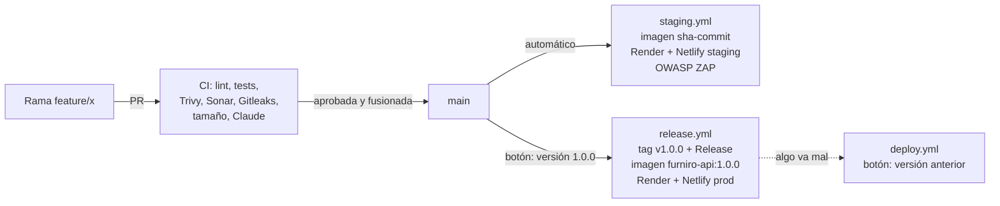

# Guía de setup y CI/CD de Furniro

Guía para el profesor. Qué hay montado, qué falta configurar y cómo funciona el ciclo de CI/CD.

## 1. El ciclo completo



En tres frases:

1. **CI**: cada PR pasa los checks. Sin todos en verde, no se puede fusionar.
2. **Staging**: cada vez que algo entra en `main`, se despliega solo. Staging es siempre el reflejo de `main`.
3. **Producción**: tú pulsas un botón y escribes la versión. Se crea el tag y la Release, se publica la imagen en Docker Hub con ese número y se despliega.

### ¿Staging también con versiones?

No. Staging usa el commit (`staging-abc1234`) y producción usa versiones (`1.0.0`).

- Si staging usara la versión de `package.json`, cada PR tendría que subirla. Con 6 parejas fusionando a la vez, chocarían todas en la misma línea de `package.json`.
- La versión es una decisión de producto ("esto ya se puede enseñar"), así que la decide quien pulsa el botón: tú.
- Con el commit sabes exactamente qué hay en staging: el pie de la web lo enseña (`Web staging-abc1234 · API staging-abc1234`).

### ¿Cómo sabe producción qué desplegar?

Pulsas **Actions → release → Run workflow** y escribes la versión (por ejemplo `1.0.0`). El workflow:

1. Comprueba que la versión es válida y no existe.
2. Crea el tag `v1.0.0` sobre lo que hay ahora en `main` (lo mismo que ya está en staging) y la GitHub Release con las notas de las PRs.
3. Construye la imagen desde ese tag y la sube a Docker Hub como `furniro-api:1.0.0` y `latest`.
4. Pide a Render que despliegue `furniro-api:1.0.0` y espera a que `/api/v1/health` responda `"version": "1.0.0"`.
5. Construye la tienda y el backoffice desde el tag y los sube a Netlify producción.

**Rollback:** **Actions → deploy → Run workflow**, eliges `production` y escribes una versión anterior (`0.9.0`). Despliega esa imagen y esa web otra vez, sin construir nada.

Netlify no despliega imágenes Docker, solo ficheros estáticos. Por eso la API va en imagen (Render) y las webs se construyen y se suben con `netlify deploy` desde GitHub Actions.

## 2. Qué hay en el repo

| Fichero | Qué hace |
|---|---|
| `.github/workflows/ci.yml` | Checks de la PR. Solo revisa las carpetas que cambia la PR (`api`, `shop`, `backoffice`, `database`); `pr-size` y `secrets` van siempre. Al final, `ci-ok` resume todo |
| `.github/workflows/staging.yml` | Push a `main`: imagen `sha-<commit>`, despliegue en staging y OWASP ZAP |
| `.github/workflows/release.yml` | Botón: versión a producción |
| `.github/workflows/deploy.yml` | Lo usan los dos anteriores. También es el botón de rollback |
| `.github/workflows/claude-review.yml` | Revisión automática de cada PR con Claude |
| `.github/dependabot.yml` | PRs semanales para actualizar dependencias |
| `sonar-project.properties` | Un proyecto de Sonar para todo el monorepo |
| `CLAUDE.md` | Normas del proyecto. Las leen la IA de los alumnos y el revisor |

Seguridad en la pipeline: `npm audit` (dependencias), Gitleaks (secretos), Trivy (imagen Docker), SonarQube Cloud (código), Dependabot y OWASP ZAP (ataque básico a staging, solo avisa).

Mientras no configures nada, los workflows de staging, release, Sonar y Claude **se saltan solos** (salen en gris). El CI básico funciona desde el primer día.

## 3. Tareas de setup

| # | Tarea | Estado |
|---|---|---|
| S1 | Monorepo con `api/`, `shop/`, `backoffice/`, `database/` | Hecho en esta PR |
| S2 | Base de datos: `schema.sql` + `seed.sql` + `compose.yaml` (era la tarjeta C4) | Hecho en esta PR |
| S3 | Módulos vacíos en la API y páginas vacías en las webs, ya enlazados | Hecho en esta PR |
| S4 | CI de PR | Hecho en esta PR |
| S5 | Ruleset de `main` que exige los checks | Tú (apartado 4.1) |
| S6 | Base de datos de staging y producción en Supabase | Tú (4.2) |
| S7 | Docker Hub, Render y Netlify | Tú (4.3 a 4.5) |
| S8 | Entornos, secretos y variables en GitHub | Tú (4.6) |
| S9 | SonarQube Cloud | Tú (4.7) |
| S10 | Revisor de PRs con Claude | Tú (apartado 5) |
| S11 | Invitar a los alumnos como colaboradores (Write) | Tú |

### Lo de la "base de autenticación"

Me refería a esto: casi todas las tarjetas necesitan saber **quién** hace la petición (el token) y si es `ADMIN`. Eso son dos piezas: el `AuthGuard` y el `AdminGuard`. Si no existen, las parejas 4, 5 y 6 se quedan esperando.

No lo he metido en el setup porque es la tarjeta **C2** (iniciar sesión), que salió en la clase de BDD y es buena para los alumnos. La propuesta, en `docs/backlog.md`: la pareja 1 empieza por la API de C2 y la fusiona el primer día; el resto empieza por lo que no necesita login. Si prefieres que nadie espere, la puedes hacer tú en directo el primer día (es lo mismo que en la clase de autenticación de NestJS).

## 4. Configuración paso a paso

### 4.1. Ruleset de `main`

**Settings → Code, planning, and automation → Rulesets → New branch ruleset**, sobre la rama por defecto:

- Require a pull request before merging (1 aprobación: la de otra pareja o la tuya).
- Require status checks to pass: **solo `ci-ok`**. Es el check que resume los demás: sale en verde si todo lo que tenía que pasar ha pasado. Así una PR que solo toca `shop/` no se queda esperando al check de la API, que se ha saltado.
- Block force pushes.

Los checks solo aparecen en el buscador después de que hayan corrido una vez (por ejemplo, en esta PR).

### 4.2. Bases de datos (Supabase)

Dos proyectos: `furniro-staging` y `furniro-prod`. En cada uno, **SQL Editor**: pega `database/schema.sql` y luego `database/seed.sql` (en producción, si quieres, solo el schema y las categorías).

Después sube las imágenes de los productos a Supabase Storage con el script de `database/scripts/` y cambia sus URLs: los pasos están en [`database/README.md`](../database/README.md).

Para la conexión usa el **Session pooler** y termina la URL en `?sslmode=no-verify` (Render no sale por IPv6 y `pg` falla con `sslmode=require`).

### 4.3. Docker Hub

1. Crea un **Personal access token** (Read & Write) en Account settings → Personal access tokens.
2. Las imágenes saldrán como `<tu-usuario>/furniro-api`, públicas.

### 4.4. Render (API)

Dos Web Services, `furniro-api-staging` y `furniro-api-prod`, con **Deploy an existing image**:

- Imagen: `docker.io/<tu-usuario>/furniro-api:staging` (staging) y `docker.io/<tu-usuario>/furniro-api:latest` (prod). La primera vez tendrás que haber ejecutado el workflow una vez para que exista la imagen, o crear el servicio con `node:24-alpine` y cambiarla después.
- Environment: `DATABASE_URL`, `JWT_SECRET` (uno distinto en cada entorno), `CORS_ORIGIN` (las dos URLs de Netlify de ese entorno, separadas por comas) y `SHIPPING_COST=8`.
- Settings → **Deploy Hook**: copia la URL de cada servicio.

### 4.5. Netlify (webs)

Cuatro sites vacíos: `furniro-shop-staging`, `furniro-backoffice-staging`, `furniro-shop`, `furniro-backoffice`.

- Créalos con **Add new site → Deploy manually** (no los conectes a GitHub: los despliega la pipeline).
- De cada uno copia el **Site ID** (Site configuration → General).
- User settings → Applications → **Personal access token**: uno para todos.

### 4.6. GitHub: entornos, secretos y variables

**Settings → Environments**: crea `staging` y `production`. En `production` marca **Required reviewers** → tú (gratis en repos públicos; así el botón de release te pide confirmación antes de desplegar).

| Nombre | Tipo | Dónde | Valor |
|---|---|---|---|
| `DOCKERHUB_USERNAME` | Variable | Repositorio | Tu usuario de Docker Hub |
| `DOCKERHUB_TOKEN` | Secreto | Repositorio | Token de 4.3 |
| `NETLIFY_AUTH_TOKEN` | Secreto | Repositorio | Token de 4.5 |
| `RENDER_DEPLOY_HOOK` | Secreto | Entorno (cada uno el suyo) | Deploy Hook de 4.4 |
| `API_URL` | Variable | Entorno | `https://furniro-api-staging.onrender.com/api/v1` |
| `SHOP_URL` | Variable | Entorno | URL de Netlify de la tienda |
| `BACKOFFICE_URL` | Variable | Entorno | URL de Netlify del backoffice |
| `SHOP_NETLIFY_SITE_ID` | Variable | Entorno | Site ID de la tienda |
| `BACKOFFICE_NETLIFY_SITE_ID` | Variable | Entorno | Site ID del backoffice |
| `SONAR_TOKEN` | Secreto | Repositorio | Apartado 4.7 |
| `SONAR_ENABLED` | Variable | Repositorio | `true` cuando Sonar esté listo |
| `CLAUDE_CODE_OAUTH_TOKEN` | Secreto | Repositorio | Apartado 5 |
| `CLAUDE_REVIEW_ENABLED` | Variable | Repositorio | `true` cuando el revisor esté listo |

En cuanto exista `DOCKERHUB_USERNAME`, el siguiente push a `main` despliega staging.

### 4.7. SonarQube Cloud (plan OSS)

1. Entra en sonarcloud.io con GitHub e importa el repositorio (tiene que ser público para el plan OSS).
2. En **Administration → Analysis Method**, desactiva **Automatic Analysis** (lo hace la pipeline).
3. Copia la organización y la project key en `sonar-project.properties` (los dos `CHANGE_ME`).
4. Crea un token (My Account → Security) y guárdalo como `SONAR_TOKEN`. Pon `SONAR_ENABLED=true`.

## 5. Revisor de PRs con Claude

Usa la GitHub Action oficial `anthropics/claude-code-action@v1` con el plugin `code-review`: deja comentarios en las líneas de la PR. Lee el `CLAUDE.md` del repo, donde están las normas y cómo tiene que comentar (en español, con pistas, sin dar la solución).

### Camino rápido (recomendado)

1. En tu ordenador, dentro del repo, abre Claude Code (`claude`).
2. Escribe `/install-github-app` y sigue los pasos: instala la app de Claude en el repo y crea el secreto. Necesitas ser admin del repo.
3. Si te propone su propio workflow, quédate con el nuestro (`claude-review.yml`) o compáralos.
4. Pon la variable `CLAUDE_REVIEW_ENABLED=true`.

### Camino manual

1. Instala la app: https://github.com/apps/claude (solo en este repo).
2. En tu terminal: `claude setup-token`. Copia el token que sale y guárdalo como secreto `CLAUDE_CODE_OAUTH_TOKEN`. Usa tu suscripción de Claude (Pro o Max).
3. Pon la variable `CLAUDE_REVIEW_ENABLED=true`.

### A tener en cuenta

- Solo revisa PRs de ramas de este repo (no de forks), y la persona que abre la PR necesita permiso de escritura. Por eso los alumnos van como colaboradores con Write.
- Cada revisión gasta uso de tu suscripción. Está limitado a 30 turnos y 15 minutos por PR. Con PRs de menos de 400 líneas, el gasto es pequeño.
- El workflow tiene que estar en `main` para que funcione: no revisará esta PR, sí las siguientes.
- Claude no aprueba ni bloquea: solo comenta. La aprobación sigue siendo de una persona.

## 6. Arrancar en local

```bash
docker compose up -d                    # base de datos con datos de prueba

cd api && cp .env.example .env && npm install && npm run start:dev
# http://localhost:3000/api/v1/health y http://localhost:3000/docs

cd shop && cp .env.example .env && npm install && npm run dev        # http://localhost:5173
cd backoffice && cp .env.example .env && npm install && npm run dev  # http://localhost:5174
```

Usuarios de prueba (contraseña `Furniro123`): `luis@furniro.com` (ADMIN), `ana@mail.com` y `pedro@mail.com`.
